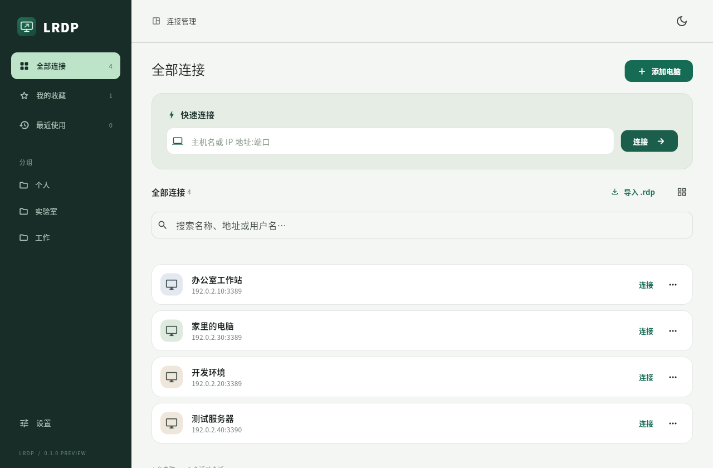
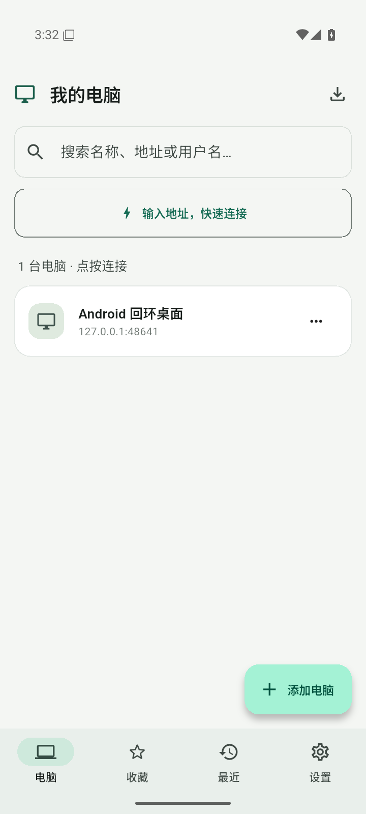
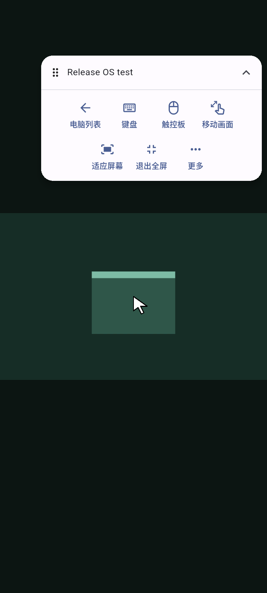
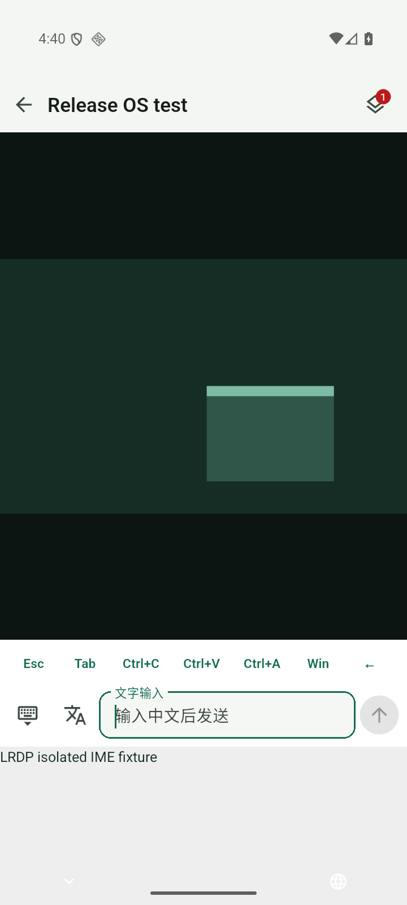

# LRDP

LRDP 是基于 **Flutter + FreeRDP** 的开源远程桌面客户端，面向手机和桌面的日常 RDP 连接。Flutter 提供界面与交互，内嵌 FreeRDP 处理远程连接、画面、输入和虚拟通道。

当前版本为 **0.1.0 开发预览**，目标平台为 Linux、Android、Windows、macOS 和 iOS。各平台的构建与验证进度见下表。

[下载预览版](https://github.com/lucinhu/LRDP/releases/tag/v0.1.0-preview.3) · [使用指南](docs/USAGE.md) · [构建指南](docs/BUILDING.md) · [剪贴板与文件](docs/CLIPBOARD.md) · [验收记录](docs/VERIFICATION.md)



## 手机界面

<table>
  <tr>
    <th>连接列表</th>
    <th>全屏会话与悬浮工具栏</th>
    <th>文字输入与特殊按键</th>
  </tr>
  <tr>
    <td></td>
    <td></td>
    <td></td>
  </tr>
</table>

以上截图来自 Android 模拟器，使用本地回环测试连接。远程画面中的色块是测试桌面；输入截图展示测试输入法，实际软键盘随设备与输入法变化。

## 主要功能

- **检查更新**：从 GitHub Releases 手动检查正式版或预览版，查看说明并打开对应系统和架构的下载；私有仓库可使用安全存储的只读令牌。
- **连接管理**：快速连接、分组、收藏、搜索、最近使用、多个会话切换，以及 `.rdp` 配置导入与导出。
- **手机操作**：全屏会话、可拖动和收起的悬浮工具栏、触控板与直接触控、双指滚动、右键、缩放和拖拽。键盘展开时仍可操作远程画面。
- **文字与键盘**：中文输入、整段文字粘贴和软键盘按键模拟。Ctrl、Shift、Alt、Win 支持单次组合与锁定保持，扩展栏可切换数字／符号和导航／功能键。
- **画面显示**：自动分辨率、动态调整分辨率、缩放与平移、平滑／锐利缩放、远端鼠标光标、H.264 软件解码，以及随屏幕刷新率调整的显示帧率上限。
- **剪贴板与文件**：文字与双向图片剪贴板、选择本机文件粘贴到远端，以及通过文件中转站双向复制文件。
- **外观与语言**：系统配色、跟随系统的深浅主题，支持简体中文、繁体中文和 English。
- **会话恢复与声音**：有次数上限、可取消的掉线重连；可选远程声音播放，离开会话时暂停，回到会话后继续。
- **凭据与证书**：密码使用系统安全存储；配置导出不含密码。证书指纹需明确确认，可选择仅本次信任或保存指纹。

动态分辨率、剪贴板、文件和声音需要服务端支持并允许相应重定向。显示帧率上限最高可设为 240 帧/秒，实际帧率取决于远端输出、屏幕、网络与设备性能。

## 平台进度

| 平台 | 当前进度 |
| --- | --- |
| Linux | 已提供 x86_64 AppImage，基于 Ubuntu 22.04 构建；Arch 私有 X11 中的 FUSE/解压启动、窗口、输入、全屏和回环 RDP 测试通过。其他发行版与原生 Wayland 待验收。 |
| Android | 当前 Release 提供 ARM64 APK；此前有 x86_64 测试构建。多项输入、手势、声音和剪贴板功能通过隔离模拟器测试，本次新输入操作与 ARM64 真机验收待完成。 |
| Windows | 已接入原生构建与显示；x64 连接核心、部分协议和文件句柄处理通过 Wine 测试。Flutter 主窗口与真实 Windows 系统待验收。 |
| macOS | 已接入工程与原生桥接，构建及设备验收待完成。 |
| iOS | 已接入工程与原生桥接，构建及设备验收待完成。 |

不同功能的验证范围并不相同；具体版本、测试方法和限制记录在 [VERIFICATION.md](docs/VERIFICATION.md)。Windows RDP、xrdp 和 GNOME 的文件剪贴板互操作仍需实测。

## 开始使用

Linux x86_64 可下载 Release 中的 `.AppImage`，赋予执行权限后直接运行：

```sh
chmod +x lrdp-0.1.0-linux-x64.AppImage
./lrdp-0.1.0-linux-x64.AppImage
```

AppImage 已包含 GTK、OpenSSL 等应用运行库；需要 glibc ≥ 2.35 与可用的 OpenGL/EGL 环境。
如果系统没有 FUSE，可用 `APPIMAGE_EXTRACT_AND_RUN=1 ./lrdp-0.1.0-linux-x64.AppImage` 启动。
Android 下载 ARM64 预览 APK。各包与完整源码、构建信息及 SHA-256 校验文件一同发布。

1. 点击“添加电脑”，填写地址、用户名、密码，以及需要的域信息。地址可直接包含端口，例如 `192.168.1.10:3390`；IPv6 使用 `[2001:db8::1]:3389`。
2. 在“连接偏好”中按需开启共享剪贴板、文件传输或远程声音。远程分辨率默认自动，也可手动指定。
3. 首次遇到需要确认的证书时，核对服务器的 SHA-256 指纹，再选择信任方式。保存连接后点击电脑卡片进入会话。

会话默认全屏，常用功能集中在悬浮工具栏。返回连接列表可保留会话，桌面端可通过标签切换连接。桌面全屏左上角提供释放控制和退出按钮；`Ctrl + Alt + Home` 释放鼠标与键盘，`Ctrl + Alt + Enter` 切换全屏。

## 手机触控与输入

触控板模式适合操作较小的远端控件；直接触控模式可按画面位置点击。

| 触控板手势 | 操作 |
| --- | --- |
| 单指滑动 | 移动远端光标 |
| 单指轻点 | 鼠标左键单击 |
| 双击后按住第二次触摸并移动 | 按住鼠标左键拖拽 |
| 双指轻点 | 鼠标右键单击 |
| 双指上下或左右滑动 | 竖向或横向滚动 |
| 双指捏合 | 缩放画面 |

放大后，光标接近屏幕边缘时视野会跟随移动。桌面实体触控板也支持双指滚动和捏合缩放。
设置中的“触控板指针速度”可选 50%–200%，不影响直接触控或双指滚动；
“缩放显示”可选平滑或锐利像素，只调整本机显示，不改变服务端编码画质。

打开工具栏中的“键盘”，可按输入场景选择模式：

| 输入模式 | 适用场景 |
| --- | --- |
| 文字输入 | 使用本机输入法输入需要的文字，再点击发送；通过 Unicode 按键提交。 |
| 粘贴输入 | 将完整文字通过共享剪贴板发送，适合不接受直接 Unicode 输入的远端应用。 |
| 键盘模拟 | 即时发送英文、数字、符号和编辑按键；也可输入拼音交给远端输入法选词。 |

默认使用键盘模拟，并记住最近选择的模式。键盘模拟隐藏本地输入框，支持回车、退格和方向键事件。未发送的文字草稿在收起、重开与切换模式时保留，仅存于当前连接内存。软键盘上方的锁开关决定修饰键只使用一次还是持续保持；展开第二排后，点击数字按钮可切换数字／符号，切换时保留输入法。输入时仍可触控远程画面。详细说明见 [使用指南](docs/USAGE.md)。

[手机连接列表](docs/screenshots/phone-workspace.png) · [手机会话工具](docs/screenshots/phone-remote.png) · [Android 模拟器中文输入](docs/screenshots/android-keyboard.png) · [横屏键盘](docs/screenshots/android-landscape-keyboard.png)

## 剪贴板与文件

连接前开启“共享剪贴板”，再选择需要的操作：

| 内容 | 使用方法 |
| --- | --- |
| 本机文字 | 点选远端输入位置，选择“更多 → 粘贴本机文字”。 |
| 图片内容 | 选择“更多 → 粘贴本机图片”或“选择图片粘贴”；远端复制的图片可同步到当前活动会话的本机剪贴板。 |
| 本机文件 | 先在远端打开目标文件夹，再选择“更多 → 选择文件粘贴”。 |
| 双向文件复制 | 在连接偏好中开启“文件传输”并重新连接，通过“文件中转站”交换文件。 |

文件粘贴保留原始文件字节和文件名，支持中文名称、多文件和空文件。每次最多 **32 个文件**，单文件最大 **256 MiB**，合计最大 **512 MiB**。请保持连接，等待远端文件管理器完成复制；“已发送粘贴请求”不代表远端已保存完毕。

中转站在远程 Windows 中的路径为 `\\tsclient\LRDP`。远端为 Linux 时，访问方式取决于运行的 RDP 服务端。图片粘贴传输的是图片内容；需要原始图片文件时，使用文件粘贴或中转站。

当前尚未实现远端文件剪贴板下载、读取本机文件管理器的“复制文件”内容及文件夹粘贴。反向传输可使用中转站。完整操作与限制见 [剪贴板与文件传输](docs/CLIPBOARD.md)。

## 从源码运行

需要 Flutter ≥ 3.41、Dart ≥ 3.11、CMake ≥ 3.22、Ninja、C/C++ 工具链、OpenSSL 3，以及目标平台的 Flutter 构建依赖。

以下以 Linux 为例：

```sh
git clone --recurse-submodules https://github.com/lucinhu/LRDP.git
cd LRDP
flutter pub get
bash scripts/build_ffmpeg.sh linux-x64
export LRDP_FFMPEG_ROOT="$PWD/build/deps/ffmpeg/linux-x64"
flutter run -d linux
```

已有工作区可用 `git submodule update --init --recursive` 初始化依赖。FreeRDP 3.32.2 固定在 `third_party/FreeRDP` 子模块中，适配代码独立维护，保持上游源码不变。H.264 使用 FFmpeg 9.0.2 的最小静态软件解码器。

Linux 系统依赖、Android SDK/NDK 与签名、Windows 工具链和 Apple 平台构建步骤见 [BUILDING.md](docs/BUILDING.md)。

## 开发与验证

```text
lib/                     Flutter 界面、连接配置、worker isolate 与 FFI
native/                  C ABI、协议适配、连接线程与生命周期
packages/lrdp_native/    各平台的原生构建与显示接入
third_party/FreeRDP/     固定版本的上游 Git 子模块
scripts/                 依赖构建、打包与隔离协议测试
```

常规检查使用 `flutter analyze` 和 `flutter test`。原生变更还需运行 CTest 与隔离回环协议测试；测试步骤见 [构建指南](docs/BUILDING.md)，实际结果见 [验收记录](docs/VERIFICATION.md)。

协议测试使用私有服务和虚拟桌面，单元测试、协议通过与平台设备验收分别记录。后续工作见 [开发进度](docs/ROADMAP.md)；RD Gateway、RemoteApp、多显示器和硬件视频解码仍待实现。

## 许可

LRDP 使用 [Apache-2.0](LICENSE) 许可。FreeRDP、FFmpeg、OpenSSL 等第三方组件遵循各自许可，详见 [NOTICE](NOTICE) 与 [第三方许可文件](assets/licenses/)。
